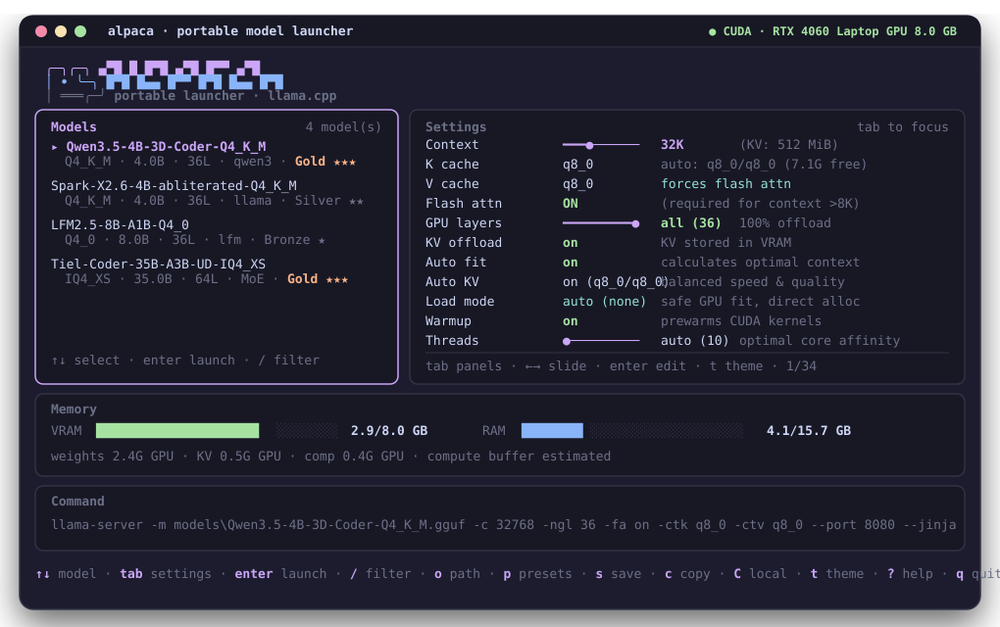

<p align="center">
  <picture>
    <source media="(prefers-color-scheme: dark)" srcset="assets/logo-wordmark-dark.svg">
    <source media="(prefers-color-scheme: light)" srcset="assets/logo-wordmark.svg">
    
  </picture>
</p>

<p align="center">
  <strong>Zero-config portable AI coding agent and local GGUF launcher for Windows.</strong><br>
  Hardware-aware VRAM auto-fitting, native agentic tools, MCP extensibility, and high-performance <code>llama.cpp</code> inference.
</p>

<p align="center">
  <a href="#quick-start--verification"></a>
  <a href="#features"></a>
  <a href="LICENSE"></a>
  <a href="https://github.com/MdHussain121/alpaca/releases"></a>
</p>

<p align="center">
  
</p>

---

## Features

- **Portable Single Executable:** `alpaca.exe` runs directly from any folder or USB drive with zero installer, zero `.NET`/Python dependency, and static-CRT `llama-server.exe` backends (`CUDA`, `CPU AVX2`, `CPU SSE4.2`).
- **Live Memory & Context Estimator:** Inspects GGUF architecture tensors, RoPE, MoE buffers, KV-cache quantization, Windows commit limits, and unified/multi-GPU memory before launch.
- **Built-In Local Coding Agent:** Terminal chat with workspace-confined file tools, checkpoint `/undo`, permission modes (`ask`, `read-auto`, `workspace-auto`), Agent Skills (`use_skill` / `save_skill`), stdio MCP servers (`mcp.toml`), SSRF-safe web search/fetch, and a runtime-interpolated built-in system prompt (`/system`).
- **Embedded Benchmarks & Tool Evaluations:** Run latency/throughput benchmarks with `alpaca bench` or automated agent function calling evaluations with `alpaca eval` right from the command line.
- **Branching Sessions & Context Meter:** JSONL sessions with `/edit` and `/regen` branches, Markdown export, live `/context` per-category token breakdown, and automatic compaction.

## Requirements

- **OS:** Windows 10 or Windows 11 (x64)
- **GPU (optional):** NVIDIA GPU with CUDA driver (for `bin\cuda`), or any x64 CPU (SSE4.2 / AVX2 supported via `bin\cpu-compat` and `bin\cpu`)
- **Models:** Local `.gguf` files (place in `models/`, in `alpaca/models/`, next to `alpaca.exe`, or press `o` in the TUI)

## Quick Start & Verification

1. Download **`alpaca-<version>-win-x64-cuda.zip`** (NVIDIA CUDA + CPU backends) or **`alpaca-<version>-win-x64.zip`** (CPU-only backends) from Releases.
2. Verify the archive hash against `SHA256SUMS.txt`:

```powershell
Get-FileHash .\alpaca-v1.0.1-win-x64-cuda.zip -Algorithm SHA256
```

> **Windows SmartScreen note:** Release binaries are unsigned open-source builds compiled cleanly from this repository. Verify the SHA-256 checksum matches `SHA256SUMS.txt` before approving execution.

3. Extract into any folder or portable USB drive, drop your `.gguf` model files into `models/`, and launch:

```powershell
.\alpaca.exe
```

Copy [`config.example.toml`](config.example.toml) to `config.toml` (and [`mcp.toml.example`](mcp.toml.example) to `mcp.toml` if using MCP servers) to customize defaults.

## Directory Layout Options

Alpaca supports two portable layouts:

### Ultra-Clean Layout (Recommended for USB Drives)
Keeps the root of your USB drive or folder completely clutter-free with only the executable and a single `alpaca/` directory:

```text
<drive>:\
├── alpaca.exe             Portable launcher & agent executable
└── alpaca\                All application data and runtime backends
    ├── bin\               llama-server backends (cuda\, cpu\, cpu-compat\)
    ├── models\            Your .gguf model files
    ├── config.toml        Configuration file
    ├── skills\            Agent skills (skills/<name>/SKILL.md)
    ├── workspace\         Default sandboxed agent workspace
    ├── presets\           Saved launcher parameter presets
    ├── sessions\          Saved JSONL chats & Markdown exports
    └── logs\              llama-server launch logs
```

### Flat Layout
Standard layout with folders alongside `alpaca.exe`:

```text
<root>/
  alpaca.exe             Portable Go TUI & launcher
  config.toml            Configuration file
  mcp.toml               Optional stdio MCP server config
  bin/                   llama-server backends
  models/                Local GGUF models
  skills/                Agent skills
  workspace/             Agent workspace
  presets/               Presets
  sessions/              Saved sessions
  logs/                  Logs
```

## Documentation

- [Usage, Shortcuts & Slash Commands](docs/USAGE.md)
- [Benchmarks & Tool Evaluation Harness](docs/BENCHMARKS.md)
- [Hardware & OS Compatibility Matrix](docs/COMPATIBILITY.md)
- [Security Model & Permission Boundaries](docs/SECURITY.md)
- [Agent Skills Authoring & Progressive Loading](docs/SKILLS.md)
- [Building from Source & Packaging](docs/BUILDING.md)
- [Third-Party Notices](THIRD_PARTY_NOTICES.md)

## Security & Safety Limits

- **Workspace confinement:** File tools canonicalize symlinks/junctions and reject paths outside the active workspace, UNC paths, ADS streams, and reserved Windows device names.
- **Permission gates:** `run_command` (executes via `cmd.exe` with current user rights) and MCP tools (`server.tool`) always confirm unless allowlisted for the session; `/undo` reverts workspace file edits only, not external shell side effects.
- **Taint defense:** Web fetch/search results are wrapped in untrusted data tags, checked for SSRF (private/loopback/metadata IPs blocked), and elevate writes/exec calls to confirmation prompts.
- **Zero telemetry:** All state stays locally inside the launcher root folder.

## License & Notices

Licensed under the [MIT License](LICENSE). See [`THIRD_PARTY_NOTICES.md`](THIRD_PARTY_NOTICES.md) for `llama.cpp` (`MIT`), Go dependencies (`MIT` / `BSD-3-Clause`), and NVIDIA CUDA `cuBLAS` redistribution notices. `alpaca` is an independent open-source project and is not affiliated with `llama.cpp`, `ggml-org`, or NVIDIA Corporation.
